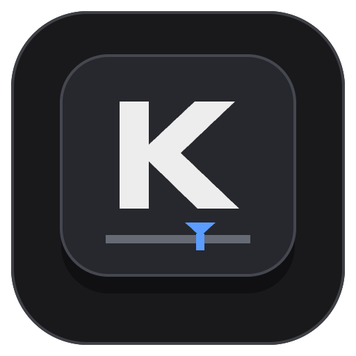
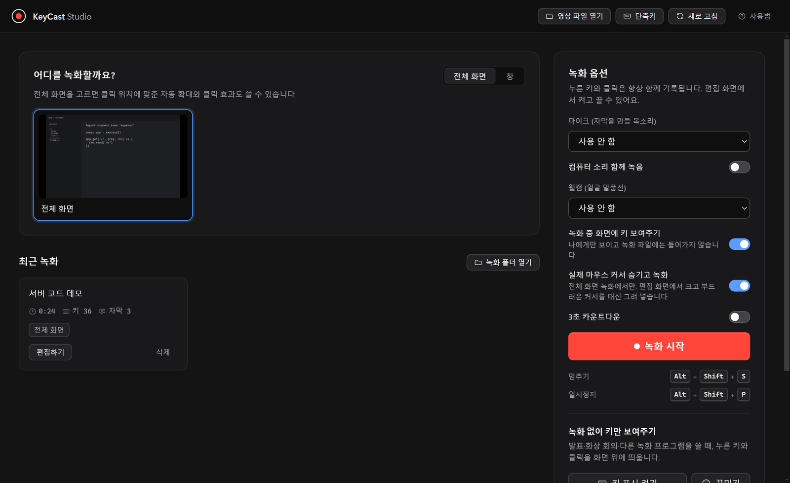
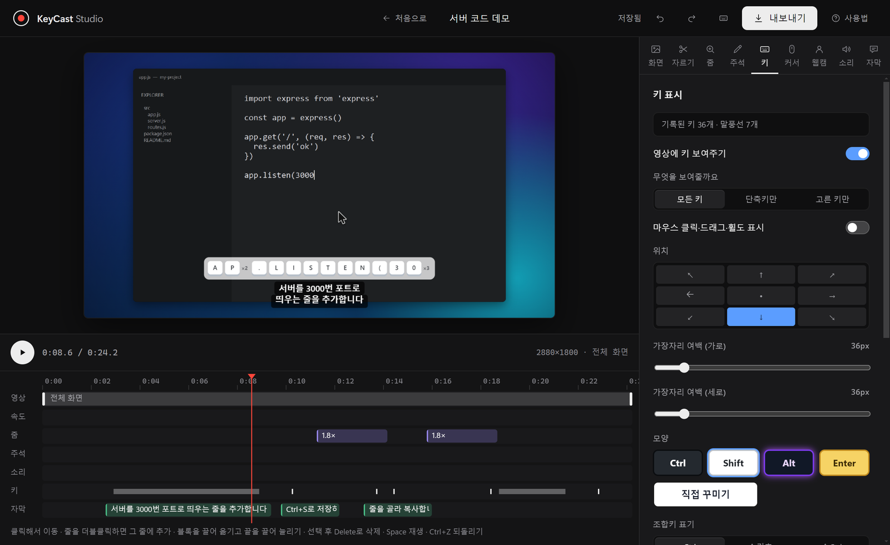

<p align="center"></p>

<h1 align="center">KeyCast Studio</h1>

<p align="center">
  <a href="README.md">English</a> · <a href="README.ko.md">한국어</a> · <b>日本語</b> · <a href="README.zh-CN.md">简体中文</a>
</p>

<p align="center">
  押したショートカットを動画に表示し、クリックした場所を自動でズームし、本物のマウスポインターの代わりに滑らかなポインターを描き、<br>
  声をこのパソコンの中で字幕に変える、Windows 用の画面録画・編集ソフトです。
</p>

<p align="center">
  <a href="https://github.com/dominkang90/keycast-studio/releases/latest">ダウンロード</a> ·
  <a href="CHANGELOG.md">変更履歴</a> ·
  <a href="CONTRIBUTING.md">コントリビュート</a> ·
  <a href="SECURITY.md">セキュリティとプライバシー</a>
</p>

<p align="center">   <a href="https://github.com/dominkang90/keycast-studio/actions/workflows/ci.yml"></a></p>


> KeyCast Studio で録画し、そのまま書き出したものです。デモの字幕は手で入力しました。アプリの画面は英語と韓国語に対応しています（[日本語訳に協力する](CONTRIBUTING.md#translating-the-app)）。

## キーボードの記録について

動画にキーを表示するため、押したキーを読み取ります。インストールの前にお読みください。

- **いつ:** キーとクリックを記録するのは録画中だけです。「録画せずにキーだけ表示」モードは画面に描くだけで、何も保存しません。
- **何を:** 初期設定では、単独で入力した文字・数字・記号は保存する前に捨てられます。パスワードなどの入力が録画ファイルに残ることはありません。ショートカット（Ctrl・Alt・Win の組み合わせ、F キー、Esc）と Enter や矢印キーなどだけが残ります。タイピングも動画に出したい場合は録画オプションの **타이핑한 글자도 기록**（入力した文字も記録）をオンにしてください。
- **どこに:** すべてこのパソコンの `ビデオ\KeyCast Studio` フォルダーに残り、どこにも送信しません。インターネットは、初めて字幕を作るときに音声認識モデルをダウンロードするためだけに使います。
- **自分で確かめる:** ソースコードはすべてここにあり、リリースごとに SHA-256 と VirusTotal の検査結果を載せています。詳しくは [SECURITY.md](SECURITY.md) をご覧ください。

## 主な機能

**録画**
- 画面全体またはウィンドウ 1 つを、マイク・パソコンの音・Web カメラと一緒に録画
- どのアプリで押したキー・クリック・ドラッグ・ホイールも時刻付きで記録
- 本物のマウスポインターを録画から外し、編集時に大きく滑らかなポインターを描き直す（インストーラーに FFmpeg 同梱）
- 録画中に画面上のキー表示をオン・オフ（録画バーのキーボードボタン、または `Alt` + `Shift` + `K`）
- 停止・一時停止・キー表示のショートカットを変更可能

**編集**
- キー表示: ショートカットのみ（初期設定）/ すべてのキー / 選んだキーのみ、9 か所の位置、4 つのテーマとカスタム、5 種類のアニメーション、`K` で動画への表示をオン・オフ
- クリックした場所へ自動ズームし、ポインターを滑らかに追従。ズーム区間は手動でも追加・調整可能
- 前後のトリミング、途中のカット、区間ごとの速度変更（0.25×〜4×）、元に戻す・やり直す
- 文字・矢印・四角・画像の注釈、個人情報をぼかして隠す機能
- 背景（色・グラデーション・背景画像・自分の画像）、余白、角丸、影、クロップ、アスペクト比（16:9、9:16、1:1、4:3）
- Web カメラの吹き出し、BGM・効果音

**字幕**
- 声をこのパソコンの中で文字に起こし（Whisper）、文単位の字幕を作成。韓国語・英語・日本語・中国語・スペイン語・ドイツ語・フランス語に対応
- 編集して動画に焼き込むか、SRT ファイルとして保存

**書き出し**
- MP4・WebM（30/60fps、720p〜4K）と GIF。カット、速度変更、追加した音が反映されます

**録画せずにキーだけ表示**
- 発表やビデオ会議、他の録画ソフトを使うときに、ショートカットとクリックだけを画面に表示

| 録画する画面を選ぶ | キー表示のスタイル |
|---|---|
|  |  |

## インストール

**必要なもの:** Windows 10 または 11（64 ビット）

[最新リリース](https://github.com/dominkang90/keycast-studio/releases/latest)からダウンロードしてください。

| ファイル | 用途 |
|---|---|
| **KeyCast-Studio-Setup-x.y.z.exe** | おすすめ。FFmpeg を含めてすべてインストールし、スタートメニュー・デスクトップのショートカットとアンインストーラーを作成します |
| KeyCast-Studio-Portable-x.y.z.exe | 1 ファイルでインストール不要、そのまま実行できます。FFmpeg 同梱。起動のたびに展開するため数秒遅く開きます |

> 初回起動時に **Windows によって PC が保護されました** と表示されたら、**詳細情報 → 実行** を選んでください。まだコード署名がないため表示されます。リリースページの SHA-256 と VirusTotal の結果でファイルを確認できます。

初めて字幕を作るとき、音声認識モデル（精度により約 40MB〜600MB）を Hugging Face から一度だけダウンロードします。

## 使い方

1. **어디를 녹화할까요?**（録画する場所）で画面全体かウィンドウを選び、右側の録画オプションを設定して **녹화 시작**（録画開始）を押します。
2. いつも通り作業します。画面上部の録画バーかショートカットで停止すると、エディターが開きます。
3. 右側のタブで仕上げて **내보내기**（書き出し）で保存します。

| ショートカット | 動作 |
|---|---|
| `Alt` + `Shift` + `S` | 録画を停止してエディターへ（どのアプリからでも、変更可） |
| `Alt` + `Shift` + `P` | 録画の一時停止 / 再開（変更可） |
| `Alt` + `Shift` + `K` | 画面上のキー表示のオン / オフ（変更可） |
| `Space` | エディターで再生 / 停止 |
| `←` `→` | 1 フレーム移動、`Shift` と一緒に 5 秒 |
| `K` | 動画のキー表示のオン / オフ |
| `S` | ここからカット区間を作る |
| `Delete` | タイムラインで選んだ区間を削除 |
| `Ctrl` + `Z` / `Ctrl` + `Y` | 元に戻す / やり直す |

## テスト環境

ベータ版です。これまでに確認したのは 1 台のパソコン（Windows 11、Intel Arc グラフィックス、2880×1800 の画面、モニター 1 台）だけです。

未確認: Windows 10、NVIDIA・AMD のグラフィックス、複数モニター、実際のマイク・Web カメラとポインター非表示録画の組み合わせ。試していただけたら、[テスト結果の報告](https://github.com/dominkang90/keycast-studio/issues/new?template=test_report.yml)（2 分ほど）がとても助かります。

## 既知の制限

- Windows 専用です。
- ハングルなどを入力しても、キー表示はキーボードの英字で表示されます。キー表示はショートカットを見せるためのものです。
- 本物のポインターを隠せるのは画面全体の録画だけです。
- 音声認識に使えるグラフィックスがない場合は CPU を使うため、動画の長さより時間がかかることがあります。

## ソースからビルド

Windows と Node.js 20 以上が必要です。

```bash
git clone https://github.com/dominkang90/keycast-studio.git
```

```bash
cd keycast-studio
```

```bash
npm install
```

```bash
npm start
```

`npm test` で単体テスト、`npm run build` で `release\KeyCast Studio-win32-x64`、`npm run dist` でインストーラーとポータブル exe を作ります（同梱する FFmpeg 8 以上が PATH に必要）。[CONTRIBUTING.md](CONTRIBUTING.md) と [docs/ARCHITECTURE.md](docs/ARCHITECTURE.md) をご覧ください。

## クレジットとオープンソース

機能の構成は [Recordly](https://github.com/webadderallorg/Recordly)（画面録画・編集）と [keyviz](https://github.com/mulaRahul/keyviz)（キー表示）を参考にしました。どちらのコードも使っていません。

| 名前 | 用途 | ライセンス |
|---|---|---|
| [Electron](https://www.electronjs.org/) | デスクトップアプリ | MIT |
| [uiohook-napi](https://github.com/SnosMe/uiohook-napi) | すべてのアプリのキー・クリックの記録 | MIT |
| [Transformers.js](https://github.com/huggingface/transformers.js) / ONNX Runtime Web | 音声認識（Whisper） | Apache-2.0 / MIT |
| [mp4-muxer](https://github.com/Vanilagy/mp4-muxer), [webm-muxer](https://github.com/Vanilagy/webm-muxer) | 動画ファイルの作成 | MIT |
| [gifenc](https://github.com/mattdesl/gifenc) | GIF の作成 | MIT |
| [FFmpeg](https://ffmpeg.org/) | ポインターなしの画面キャプチャ。インストーラーとポータブル exe に無改変で同梱し、別プログラムとして起動します | GPL-3.0（[ソース](https://ffmpeg.org/download.html)） |

## ライセンス

[MIT](LICENSE)。同梱の FFmpeg は独自のライセンスに従います。インストールしたアプリの `resources\app\bin\FFMPEG-LICENSE.txt` をご覧ください。
