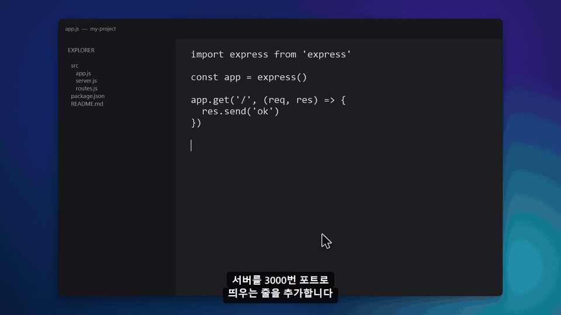
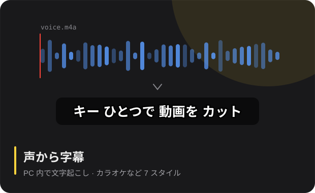

<p align="center"></p>

<p align="center">
  <a href="README.md">English</a> · <a href="README.ko.md">한국어</a> · <b>日本語</b> · <a href="README.zh-CN.md">简体中文</a>
</p>

<p align="center">
  押したショートカットを動画に表示し、クリックした場所を自動でズームし、本物のマウスポインターの代わりに滑らかなポインターを描き、<br>
  声をこのパソコンの中で字幕に変える、Windows・macOS・Linux 用の画面録画・編集ソフトです。<br>
  無料のオープンソースで、12 言語に対応しています。
</p>

<p align="center">
  <a href="https://github.com/dominkang90/keycast-studio/releases/latest">ダウンロード</a> ·
  <a href="CHANGELOG.md">変更履歴</a> ·
  <a href="CONTRIBUTING.md">コントリビュート</a> ·
  <a href="SECURITY.md">セキュリティとプライバシー</a>
</p>

<p align="center">  <a href="https://github.com/dominkang90/keycast-studio/releases/latest"></a>  <a href="https://github.com/dominkang90/keycast-studio/actions/workflows/ci.yml"></a></p>



> KeyCast Studio で録画し、そのまま書き出したものです。デモの字幕は手で入力しました。アプリの画面は日本語を含む 12 言語に対応しています（[翻訳の改善に協力する](CONTRIBUTING.md#translating-the-app)）。

<p align="center"></p>

## キーボードの記録について

<p align="center"></p>

動画にキーを表示するため、押したキーを読み取ります。インストールの前にお読みください。

- **いつ:** キーとクリックを記録するのは録画中だけです。「録画せずにキーだけ表示」モードは画面に描くだけで、何も保存しません。
- **何を:** 初期設定では、単独で入力した文字・数字・記号は保存する前に捨てられます。パスワードなどの入力が録画ファイルに残ることはありません。ショートカット（Ctrl・Alt・Win の組み合わせ、F キー、Esc）と Enter や矢印キーなどだけが残ります。タイピングも動画に出したい場合は録画オプションの **타이핑한 글자도 기록**（入力した文字も記録）をオンにしてください。
- **どこに:** すべてこのパソコンの `ビデオ\KeyCast Studio` フォルダーに残り、どこにも送信しません。インターネットは、初めて字幕を作るときに音声認識モデルをダウンロードするためだけに使います。
- **自分で確かめる:** ソースコードはすべてここにあり、リリースごとに SHA-256 と VirusTotal の検査結果を載せています。詳しくは [SECURITY.md](SECURITY.md) をご覧ください。

## 主な機能

<p align="center">
  
  
</p>
<p align="center">
  
  
</p>

**録画**
- 画面全体またはウィンドウ 1 つを、マイク・パソコンの音・Web カメラと一緒に録画
- どのアプリで押したキー・クリック・ドラッグ・ホイールも時刻付きで記録
- 本物のマウスポインターを録画から外し、編集時に大きく滑らかなポインターを描き直す（Windows は同梱、macOS・Linux は FFmpeg が必要）
- 録画中のポインターの種類（矢印・指・文字入力・サイズ変更など）を記録し、同じ形で描き直す（Windows）
- 録画中に画面上のキー表示をオン・オフ（録画バーのキーボードボタン、または `Alt` + `Shift` + `K`）
- 停止・一時停止・キー表示のショートカットを変更可能

**編集**
- キー表示: ショートカットのみ（初期設定）/ すべてのキー / 選んだキーのみ、9 か所の位置、4 つのテーマとカスタム、5 種類のアニメーション、`K` で動画への表示をオン・オフ
- クリックした場所へ自動ズームし、ポインターを滑らかに追従。ズーム区間は手動でも追加・調整可能
- 前後のトリミング、途中のカット、区間ごとの速度変更（0.25×〜4×）、元に戻す・やり直す
- 文字・矢印・四角・画像の注釈、個人情報をぼかして隠す機能
- 背景（色・グラデーション・背景画像・自分の画像）、余白、角丸、影、クロップ、アスペクト比（16:9、9:16、1:1、4:3）
- ポインター：7 種類の形、クリック効果 4 種類（波紋・二重波紋・光・はじけ）とサイズ・長さ、なめらかさ、残像、止まったら隠す
- Web カメラの吹き出し、BGM・効果音
- ほかのアプリの動画を開いて編集。Recordly の録画はポインター・クリック・自動ズームごと読み込みます

**字幕**
- 声をこのパソコンの中で文字に起こし（Whisper）、文単位の字幕を作成。韓国語・英語・日本語・中国語・スペイン語・ドイツ語・フランス語に対応
- カラオケ・強調ポップなど話している単語を強調するものを含む 7 スタイル、文字色・強調色、登場アニメーション、上・中央・下
- 編集して動画に焼き込むか、SRT ファイルとして保存

**書き出し**
- MP4・WebM（30/60fps、720p〜4K）と GIF。カット、速度変更、追加した音が反映されます
- 1920×1200 以下の録画は動画の長さより速く書き出し（11 秒の動画を約 6 秒で）

**拡張機能**
- 背景・キーテーマ・ポインターパック・クリック効果・字幕スタイルを追加するデータのパック。コードは実行しません。作り方は [docs/EXTENSIONS.md](docs/EXTENSIONS.md)

**画面**
- 12 言語：한국어, English, 日本語, 简体中文, 繁體中文, Español, Français, Deutsch, Italiano, Nederlands, Português (Brasil), Русский。最初はシステムの言語に合わせます
- キー名を Windows 式（Ctrl・Alt・Win）または Mac 式（⌃ Control・⌥ Option・⌘ Cmd）で表示

**録画せずにキーだけ表示**
- 発表やビデオ会議、他の録画ソフトを使うときに、ショートカットとクリックだけを画面に表示

| 録画する画面を選ぶ | キー表示のスタイル |
|---|---|
|  |  |

## インストール

<p align="center"></p>

**必要なもの:** Windows 10・11（64 ビット）、macOS 11 以降（Apple シリコン・Intel）、または X11 の 64 ビット Linux。macOS・Linux 版は 2.0 で追加され、まだ自動チェックのみです。macOS では初回に右クリック →「開く」で起動し、アクセシビリティと画面収録を許可してください（ポインターなし録画には `brew install ffmpeg`）。Linux では `.AppImage` か `.deb` を使い、X11 セッションでキーとクリックを記録できます（`sudo apt install ffmpeg`）。パソコンの音の録音は Windows のみです。

[最新リリース](https://github.com/dominkang90/keycast-studio/releases/latest)からダウンロードしてください。

| ファイル | 用途 |
|---|---|
| **KeyCast-Studio-Setup-x.y.z.exe** | おすすめ。FFmpeg を含めてすべてインストールし、スタートメニュー・デスクトップのショートカットとアンインストーラーを作成します |
| KeyCast-Studio-Portable-x.y.z.exe | 1 ファイルでインストール不要、そのまま実行できます。FFmpeg 同梱。起動のたびに展開するため数秒遅く開きます |

> 初回起動時に **Windows によって PC が保護されました** と表示されたら、**詳細情報 → 実行** を選んでください。まだコード署名がないため表示されます。リリースページの SHA-256 と VirusTotal の結果でファイルを確認できます。

初めて字幕を作るとき、音声認識モデル（精度により約 40MB〜600MB）を Hugging Face から一度だけダウンロードします。

## 使い方

1. **どこを録画しますか？**で画面全体かウィンドウを選び、右側の録画オプションを決めて **録画開始** を押します。言語は右上のメニューで変えられます。
2. いつもどおり作業します。画面上部の録画バーかショートカットで止めると編集画面が開きます。
3. 右側のタブ（画面・カット・ズーム・注釈・キー・ポインター・Web カメラ・サウンド・字幕）で仕上げ、**書き出し** で保存します。

| ショートカット | 動作 |
|---|---|
| `Alt` + `Shift` + `S` | 録画を止めて編集へ（どのアプリからでも、変更可） |
| `Alt` + `Shift` + `P` | 録画の一時停止 / 再開（変更可） |
| `Alt` + `Shift` + `K` | 画面上のキー表示のオン / オフ（変更可） |
| `Space` | 編集画面で再生 / 停止 |
| `←` `→` | 1 フレーム移動、`Shift` で 5 秒 |
| `K` | 動画のキー表示のオン / オフ |
| `S` | ここからカット範囲を作る |
| `Delete` | タイムラインで選んだ範囲を削除 |
| `Ctrl` + `Z` / `Ctrl` + `Y` | 元に戻す / やり直し |

Mac では `Alt` は `Option` キー、元に戻す・やり直しは `Cmd` + `Z` / `Y` です。

## テスト環境

ベータ版です。

- **Windows**：1 台（Windows 11、Intel Arc グラフィックス、2880×1800 画面、モニター 1 台）で、インストーラー・ポータブル exe・24 項目の自己チェックまで手で確認しました。
- **macOS・Linux**：リリースごとに GitHub の Mac・Linux マシンでビルドし、アプリを起動してウィンドウが開き、ホーム画面が描かれ、キー記録モジュールが読み込まれるかを自動で確認します。実機の Mac・Linux で録画した人はまだいません。

未確認：Windows 10、NVIDIA・AMD グラフィックス、複数モニター、実際のマイク・Web カメラとポインターなし録画の組み合わせ、実機の Mac・Linux。試したら [テスト結果](https://github.com/dominkang90/keycast-studio/issues/new?template=test_report.yml) を送っていただけると大きな助けになります（2 分ほどです）。

## 既知の制限

- パソコンの音の録音は Windows のみです。
- macOS：まだ Apple の公証前のため初回は右クリック →「開く」で起動し、アクセシビリティと画面収録の許可が必要です。ポインターを隠すには FFmpeg（`brew install ffmpeg`）が必要です。
- Linux：キー・クリックの記録とポインターを隠す機能は X11 セッションのみ。Wayland では画面だけが録画されます。
- ポインターの種類（指・文字入力など）の記録は Windows のみ。ほかでは矢印で描きます。
- 本物のポインターを隠せるのは全画面録画のときだけです。
- 韓国語・英語以外の翻訳は機械翻訳の助けを借りており、ネイティブの確認が必要です。
- 音声認識に使えるグラフィックカードがない場合は CPU を使い、動画の長さより時間がかかることがあります。

## ソースからビルド

Node.js 20 以上が必要です（Windows・macOS・Linux）。

```bash
git clone https://github.com/dominkang90/keycast-studio.git
```

```bash
cd keycast-studio
```

```bash
npm install
```

```bash
npm start
```

`npm test` で単体テスト。`npm run dist` で Windows のインストーラーとポータブル exe（`FFMPEG_PATH` か PATH の FFmpeg 8 以上を同梱し、wgc-capture をダウンロード）、`npm run dist:mac` で macOS の dmg・zip、`npm run dist:linux` で AppImage・deb を作ります。バージョンタグを push すると GitHub Actions が Mac・Linux 版を作ります。[CONTRIBUTING.md](CONTRIBUTING.md) と [docs/ARCHITECTURE.md](docs/ARCHITECTURE.md) をご覧ください。

## クレジットとオープンソース

機能の構成は [Recordly](https://github.com/webadderallorg/Recordly)（画面録画・編集）と [keyviz](https://github.com/mulaRahul/keyviz)（キー表示）を参考にしました。どちらのコードも使っていません。

| 名前 | 用途 | ライセンス |
|---|---|---|
| [Electron](https://www.electronjs.org/) | デスクトップアプリ | MIT |
| [uiohook-napi](https://github.com/SnosMe/uiohook-napi) | すべてのアプリのキー・クリックの記録 | MIT |
| [Transformers.js](https://github.com/huggingface/transformers.js) / ONNX Runtime Web | 音声認識（Whisper） | Apache-2.0 / MIT |
| [mp4-muxer](https://github.com/Vanilagy/mp4-muxer), [webm-muxer](https://github.com/Vanilagy/webm-muxer) | 動画ファイルの作成 | MIT |
| [gifenc](https://github.com/mattdesl/gifenc) | GIF の作成 | MIT |
| [mediabunny](https://github.com/Vanilagy/mediabunny) | 高速書き出しのための動画読み込み | MPL-2.0 |
| [koffi](https://koffi.dev/) | Windows が表示しているポインターの種類の取得 | MIT |
| [wgc-capture](https://github.com/webadderallorg/Recordly/tree/v1.4.0/electron/native/wgc-capture) ([Recordly](https://github.com/webadderallorg/Recordly)) | Windows Graphics Capture による画面キャプチャ。無改変で同梱し、別プログラムとして実行します | AGPL-3.0 |
| [FFmpeg](https://ffmpeg.org/) | ポインターなしの画面キャプチャ。インストーラーとポータブル exe に無改変で同梱し、別プログラムとして起動します | GPL-3.0（[ソース](https://ffmpeg.org/download.html)） |

## ライセンス

[MIT](LICENSE)。同梱の FFmpeg は独自のライセンスに従います。インストールしたアプリの `resources\app\bin\FFMPEG-LICENSE.txt` をご覧ください。
