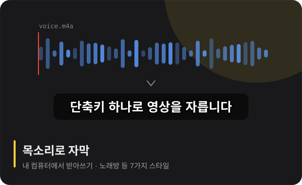

<p align="center"></p>

<p align="center">
  <a href="README.md">English</a> · <b>한국어</b> · <a href="README.ja.md">日本語</a> · <a href="README.zh-CN.md">简体中文</a>
</p>

<p align="center">
  누른 단축키를 영상에 보여 주고, 클릭한 곳을 자동으로 확대하고, 실제 마우스 커서 대신 부드러운 커서를 그려 넣고,<br>
  목소리를 이 컴퓨터 안에서 자막으로 바꿔 주는 Windows·macOS·Linux용 화면 녹화·편집 프로그램입니다.<br>
  무료 오픈 소스이고 12개 언어를 지원합니다.
</p>

<p align="center">
  <a href="https://github.com/dominkang90/keycast-studio/releases/latest">내려받기</a> ·
  <a href="CHANGELOG.md">변경 내역</a> ·
  <a href="CONTRIBUTING.ko.md">기여하기</a> ·
  <a href="SECURITY.md">보안과 개인 정보</a> ·
  <a href="사용설명서.html">사용설명서</a>
</p>

<p align="center">  <a href="https://github.com/dominkang90/keycast-studio/releases/latest"></a>  <a href="https://github.com/dominkang90/keycast-studio/actions/workflows/ci.yml"></a></p>


> KeyCast Studio로 녹화하고 그대로 내보낸 결과입니다. 시연용 자막은 직접 입력했습니다. 화면은 12개 언어를 지원합니다(첫 화면 오른쪽 위 언어 메뉴): 한국어, English, 日本語, 简体中文, 繁體中文, Español, Français, Deutsch, Italiano, Nederlands, Português (Brasil), Русский.

<p align="center"></p>

## 키보드 기록에 대해

<p align="center"></p>

영상에 키를 보여 주려면 누른 키를 알아야 합니다. 설치하기 전에 읽어 주세요.

- **언제:** 녹화하는 동안에만 키와 클릭을 기록합니다. "녹화 없이 키만 보여주기"는 화면에 그리기만 하고 아무것도 저장하지 않습니다.
- **무엇을:** 기본으로는 혼자 입력한 글자·숫자·기호를 저장하기 전에 버립니다. 그래서 비밀번호 같은 입력은 녹화 파일에 남지 않습니다. 단축키(Ctrl·Alt·Win 조합, F키, Esc)와 Enter·방향키 같은 키만 남습니다. 타이핑도 영상에 보여 주려면 첫 화면에서 **⌨ 단축키만 기록** 칩을 눌러 **타이핑까지 기록**으로 바꾸세요(**튜토리얼**을 고르면 켜집니다).
- **잠깐 멈춤:** 녹화 막대의 🔒 버튼(또는 Alt+Shift+L)을 누르면 다시 누를 때까지 키를 기록하지 않습니다. 녹화 중에 비밀번호를 칠 때 쓰세요. 막대에는 지금 무엇을 남기는지(단축키, 키·타이핑, 멈춤)가 늘 보입니다.
- **어디에:** 모든 것이 이 컴퓨터의 `동영상\KeyCast Studio` 폴더에만 남습니다. 어디로도 보내지 않습니다. 인터넷은 자막을 처음 만들 때 음성 인식 모델을 내려받는 데만 씁니다.
- **직접 확인:** 소스 코드가 모두 여기 있고, 릴리즈마다 SHA-256 값과 VirusTotal 검사 결과를 붙입니다. 자세한 내용은 [SECURITY.md](SECURITY.md)에 있습니다.

## 주요 기능

<p align="center">
  
  
</p>
<p align="center">
  
  
</p>

**녹화**
- 전체 화면 또는 창 하나를 녹화하고, 마이크·컴퓨터 소리·웹캠을 함께 담습니다.
- 어떤 프로그램에서든 키·클릭·드래그·휠을 시각과 함께 기록합니다.
- 실제 마우스 커서를 빼고 녹화한 뒤, 편집할 때 크고 부드러운 커서를 다시 그려 넣습니다(Windows는 설치 파일에 포함, macOS·Linux는 FFmpeg 필요).
- 녹화 중 보이던 커서 종류(화살표·손가락·글자 입력·크기 조절 등)를 기록해 같은 모양으로 다시 그립니다(Windows).
- 녹화 중 화면 키 표시를 켜고 끕니다(녹화 막대의 키보드 버튼 또는 `Alt` + `Shift` + `K`).
- 멈추기·일시정지·키 표시 단축키를 바꿀 수 있습니다.

**편집**
- 키 표시: 단축키만(기본) / 모든 키 / 고른 키만, 위치 9곳, 테마 4종과 직접 꾸미기, 나타나는 방식 5종, `K` 한 번으로 영상에서 켜고 끄기
- 클릭한 곳으로 자동 확대하고 커서를 부드럽게 따라갑니다. 확대 구간은 직접 넣고 고칠 수 있습니다.
- 앞뒤 자르기, 중간 잘라내기, 구간별 속도(0.25×~4×), 되돌리기·다시 하기
- 글자·화살표·네모·그림 주석, 개인 정보를 흐리게 가리기
- 배경(색·그라데이션·배경 그림·내 그림), 여백, 둥근 모서리, 그림자, 크롭, 화면 비율(16:9, 9:16, 1:1, 4:3)
- 커서: 녹화 때 Windows가 보여 준 커서 종류(화살표·손가락·글자 입력·크기 조절 등)를 따라가는 커서 묶음 6종, 스프링 움직임(프리셋 또는 세기·감쇠·무게 직접), 클릭 효과 4종(물결·겹물결·빛 번짐·터짐)과 크기·길이·진하기, 잔상, 멈춰 있으면 숨기기
- 웹캠 말풍선, 배경 음악·효과음
- 다른 프로그램으로 만든 영상 열기. Recordly 녹화는 커서·클릭·자동 확대까지 함께 가져옵니다.

**자막**
- 목소리를 이 컴퓨터 안에서 받아 적어(Whisper) 문장 단위 자막을 만듭니다. 한국어·영어·일본어·중국어·스페인어·독일어·프랑스어.
- 노래방·강조 팝처럼 말하는 낱말을 강조하는 스타일을 포함해 7종, 글자·강조 색, 나타나는 방식, 위·가운데·아래
- 고치고, 영상에 넣거나 SRT 파일로 저장합니다.

**내보내기**
- MP4·WebM(30/60fps, 720p~4K)과 GIF. 잘라낸 구간, 속도 변경, 추가한 소리가 반영됩니다.
- 1920×1200 이하 녹화는 영상 길이보다 빨리 내보냅니다(11초 영상을 약 6초에).

**확장 기능**
- 배경·키 테마·커서 묶음·클릭 효과·자막 스타일을 더하는 데이터 묶음. 코드는 실행하지 않습니다. 공식 확장 6종이 들어 있고, **확장 만들기** 화면에서 실시간 미리보기를 보며 직접 만들 수 있습니다. 자세한 내용은 [docs/EXTENSIONS.md](docs/EXTENSIONS.md)

**화면**
- 12개 언어: 한국어, English, 日本語, 简体中文, 繁體中文, Español, Français, Deutsch, Italiano, Nederlands, Português (Brasil), Русский. 처음에는 시스템 언어를 따릅니다.
- 키 이름을 Windows식(Ctrl·Alt·Win) 또는 Mac식(⌃ Control·⌥ Option·⌘ Cmd)으로 표시

**녹화 없이 키만 보여주기**
- 발표·화상 회의·다른 녹화 프로그램을 쓸 때 단축키와 클릭만 화면 위에 띄웁니다.

| 녹화할 화면 고르기 | 키 표시 꾸미기 |
|---|---|
|  |  |

## 설치

<p align="center"></p>

**필요한 것:** Windows 10·11 (64비트), macOS 11 이상(Apple 실리콘·Intel), 또는 X11을 쓰는 64비트 Linux. 맥·리눅스판은 2.0에서 처음 나왔고 아직 자동 검사만 거쳤습니다. 써 보시면 [테스트 결과](https://github.com/dominkang90/keycast-studio/issues/new?template=test_report.yml)를 꼭 알려 주세요.

[최신 릴리즈](https://github.com/dominkang90/keycast-studio/releases/latest)에서 받으세요.

| 파일 | 용도 |
|---|---|
| **KeyCast-Studio-Setup-x.y.z.exe** | 추천. FFmpeg까지 모두 설치하고 시작 메뉴·바탕화면 바로가기와 제거 프로그램을 만듭니다 |
| KeyCast-Studio-Portable-x.y.z.exe | 파일 하나, 설치 없이 바로 실행. FFmpeg 포함. 실행할 때마다 먼저 풀어서 몇 초 늦게 열립니다 |

> 처음 실행할 때 **Windows의 PC 보호** 창이 뜨면 **추가 정보 → 실행**을 누르세요. 아직 코드 서명 인증서가 없어서 나오는 안내입니다. 릴리즈 페이지의 SHA-256 값과 VirusTotal 결과로 파일을 확인할 수 있습니다.

**macOS:** `KeyCast-Studio-x.y.z-mac-arm64.dmg`(Apple 실리콘) 또는 `-mac-x64.dmg`(Intel)를 받아 앱을 응용 프로그램 폴더로 끌어 넣습니다. 아직 Apple 공증을 받지 않아 처음 열 때 macOS가 막으면 **시스템 설정 → 개인정보 보호 및 보안**에서 **그래도 열기**를 누르세요. (2.1.1 이전 버전에서 **"손상되었기 때문에 열 수 없습니다"**가 나오면 터미널에서 `xattr -cr "/Applications/KeyCast Studio.app"`을 한 번 실행하세요.) 그다음 시스템 설정 → 개인정보 보호 및 보안에서 **손쉬운 사용**(키 기록)과 **화면 기록**을 허용합니다. 앱의 **권한 설정 열기** 버튼이 이 화면을 열어 줍니다. 커서 숨김 녹화에는 FFmpeg가 필요합니다: `brew install ffmpeg`. 컴퓨터 소리 녹음은 Windows에서만 됩니다.

**Linux:** `KeyCast-Studio-x.y.z-linux-x86_64.AppImage`(실행 권한을 주고 실행) 또는 `KeyCast-Studio-x.y.z-linux-amd64.deb`(`sudo apt install ./KeyCast-Studio-*.deb`). 키·클릭 기록과 커서 숨김 녹화는 **X11** 세션에서만 됩니다. Wayland에서는 화면만 녹화됩니다. 커서 숨김 녹화: `sudo apt install ffmpeg`.

자막을 처음 만들 때 음성 인식 모델(정확도에 따라 약 40MB~600MB)을 Hugging Face에서 한 번 내려받습니다.

## 사용법

1. 전체 화면이나 창을 고르고, 무엇을 녹화하는지(**튜토리얼**·**제품 데모**·**그냥 녹화**) 고른 뒤 **녹화 시작**을 누릅니다. 설정은 한 줄짜리 칩으로 보이고 누르면 바뀝니다. 단축키·확장·언어는 **⚙ 설정**에 있습니다.
2. 평소처럼 작업합니다. 화면 위쪽 녹화 막대나 단축키로 멈추면 편집 화면이 열립니다.
3. 오른쪽의 세 묶음 **꾸미기**(화면·커서·키·웹캠, 추천 스타일 한 번에)·**편집**(자르기·줌·주석)·**소리·자막**에서 다듬습니다. 자주 안 쓰는 설정은 **자세히**에 접혀 있습니다. 다 되면 **MP4로 저장**을 누르세요. 동영상 폴더에 바로 저장됩니다. 형식·화질·위치를 고르려면 **내보내기 설정…**을 누르세요.

| 단축키 | 하는 일 |
|---|---|
| `Alt` + `Shift` + `S` | 녹화 멈추고 편집으로 (어느 프로그램에서든, 바꿀 수 있음) |
| `Alt` + `Shift` + `P` | 녹화 일시정지 / 다시 시작 (바꿀 수 있음) |
| `Alt` + `Shift` + `K` | 화면 키 표시 켜기 / 끄기 (바꿀 수 있음) |
| `Space` | 편집 화면에서 재생 / 정지 |
| `←` `→` | 한 프레임 이동, `Shift`와 함께 5초 |
| `K` | 영상의 키 표시 켜기 / 끄기 |
| `S` | 지금 위치에 잘라낼 구간 만들기 |
| `Delete` | 타임라인에서 고른 구간 지우기 |
| `Ctrl` + `Z` / `Ctrl` + `Y` | 되돌리기 / 다시 하기 |

Mac에서는 `Alt`가 `Option` 키이고, 되돌리기·다시 하기는 `Cmd` + `Z` / `Y`입니다.

## 시험한 환경

베타 버전입니다.

- **Windows**: 컴퓨터 한 대(Windows 11, Intel Arc 그래픽, 2880×1800 화면, 모니터 한 대)에서 설치 파일·휴대용 exe·앱 자체 점검 24개 항목까지 직접 확인했습니다.
- **macOS·Linux**: 릴리즈마다 GitHub의 맥·리눅스 컴퓨터에서 만들고, 앱을 켜서 창이 열리고 첫 화면이 그려지고 키 기록 모듈이 올라오는지 자동으로 확인합니다. 실제 맥·리눅스 컴퓨터에서 녹화해 본 사람은 아직 없습니다.

아직 확인하지 못한 것: Windows 10, NVIDIA·AMD 그래픽, 모니터 여러 대, 실제 마이크·웹캠과 커서 숨김 녹화를 함께 쓰는 경우, 실제 맥·리눅스 컴퓨터. 써 보셨다면 [테스트 결과 보내기](https://github.com/dominkang90/keycast-studio/issues/new?template=test_report.yml)가 2분이면 되고 큰 도움이 됩니다.

## 알려진 제한

- 컴퓨터 소리 녹음은 Windows에서만 됩니다.
- macOS: 아직 Apple 공증 전이라 처음에는 오른쪽 클릭 → 열기로 실행하고, 손쉬운 사용·화면 기록 권한이 필요합니다. 커서 숨김에는 FFmpeg(`brew install ffmpeg`)가 필요합니다.
- Linux: 키·클릭 기록과 커서 숨김은 X11 세션에서만 됩니다. Wayland에서는 화면만 녹화됩니다.
- 커서 종류(손가락·글자 입력 등) 기록은 Windows에서만 됩니다. 다른 운영체제에서는 화살표로 그립니다.
- 실제 커서 숨기기는 전체 화면 녹화에서만 됩니다.
- 한글 타이핑은 녹화할 때 한글 입력기가 한글 상태였으면 "안녕"처럼 한글로 보입니다. 입력기 상태는 Windows에서만 알 수 있어, 맥·리눅스에서는 키 탭의 **항상 한글**을 고르세요. 일본어·중국어 입력기는 아직 영문 키 글자로 나옵니다.
- 한국어·영어를 뺀 번역은 기계 번역의 도움을 받았고 원어민 검토가 필요합니다.
- 음성 인식에 쓸 수 있는 그래픽카드가 없으면 CPU를 써서 영상 길이보다 오래 걸릴 수 있습니다.

## 직접 빌드하기

Node.js 20 이상이 필요합니다(Windows·macOS·Linux).

```bash
git clone https://github.com/dominkang90/keycast-studio.git
```

```bash
cd keycast-studio
```

```bash
npm install
```

```bash
npm start
```

`npm test`는 단위 테스트입니다. `npm run dist`는 Windows 설치 파일과 휴대용 exe(`FFMPEG_PATH`나 PATH의 FFmpeg 8 이상을 넣고 wgc-capture를 내려받음), `npm run dist:mac`은 macOS dmg·zip, `npm run dist:linux`는 AppImage·deb를 만듭니다. 버전 태그를 올리면 GitHub Actions가 맥·리눅스 파일을 만듭니다. [CONTRIBUTING.ko.md](CONTRIBUTING.ko.md)와 [docs/ARCHITECTURE.md](docs/ARCHITECTURE.md)를 보세요.

## 참고한 프로젝트와 오픈소스

기능 구성은 [Recordly](https://github.com/webadderallorg/Recordly)(화면 녹화·편집)와 [keyviz](https://github.com/mulaRahul/keyviz)(키 표시)를 참고했습니다. 두 프로젝트의 코드는 가져오지 않았습니다.

| 이름 | 용도 | 라이선스 |
|---|---|---|
| [Electron](https://www.electronjs.org/) | 데스크톱 앱 | MIT |
| [uiohook-napi](https://github.com/SnosMe/uiohook-napi) | 모든 프로그램의 키·클릭 기록 | MIT |
| [Transformers.js](https://github.com/huggingface/transformers.js) / ONNX Runtime Web | 음성 인식(Whisper) | Apache-2.0 / MIT |
| [mp4-muxer](https://github.com/Vanilagy/mp4-muxer), [webm-muxer](https://github.com/Vanilagy/webm-muxer) | 영상 파일 만들기 | MIT |
| [gifenc](https://github.com/mattdesl/gifenc) | GIF 만들기 | MIT |
| [mediabunny](https://github.com/Vanilagy/mediabunny) | 빠른 내보내기용 영상 읽기 | MPL-2.0 |
| [koffi](https://koffi.dev/) | Windows가 보여 주는 커서 종류 읽기 | MIT |
| [wgc-capture](https://github.com/webadderallorg/Recordly/tree/v1.4.0/electron/native/wgc-capture) ([Recordly](https://github.com/webadderallorg/Recordly)) | Windows Graphics Capture로 화면 캡처. 고치지 않은 상태로 들어 있고 별도 프로그램으로 실행됩니다 | AGPL-3.0 |
| [FFmpeg](https://ffmpeg.org/) | 커서 없는 화면 캡처. 설치 파일과 휴대용 exe에 고치지 않은 상태로 들어 있고 별도 프로그램으로 실행됩니다 | GPL-3.0 ([소스](https://ffmpeg.org/download.html)) |

## 라이선스

[MIT](LICENSE). 함께 배포하는 FFmpeg는 자체 라이선스를 따릅니다. 설치된 앱의 `resources\app\bin\FFMPEG-LICENSE.txt`를 보세요.
