<p align="center"></p>

<p align="center">
  <b>English</b> · <a href="README.ko.md">한국어</a> · <a href="README.ja.md">日本語</a> · <a href="README.zh-CN.md">简体中文</a>
</p>

<p align="center">
  A Windows screen recorder and editor that shows the shortcuts you press, zooms in where you click,<br>
  hides the real mouse pointer behind a smooth redrawn one, and turns your voice into subtitles on your own computer.
</p>

<p align="center">
  <a href="https://github.com/dominkang90/keycast-studio/releases/latest">Download</a> ·
  <a href="CHANGELOG.md">Changes</a> ·
  <a href="CONTRIBUTING.md">Contributing</a> ·
  <a href="SECURITY.md">Security and privacy</a>
</p>

<p align="center">   <a href="https://github.com/dominkang90/keycast-studio/actions/workflows/ci.yml"></a></p>

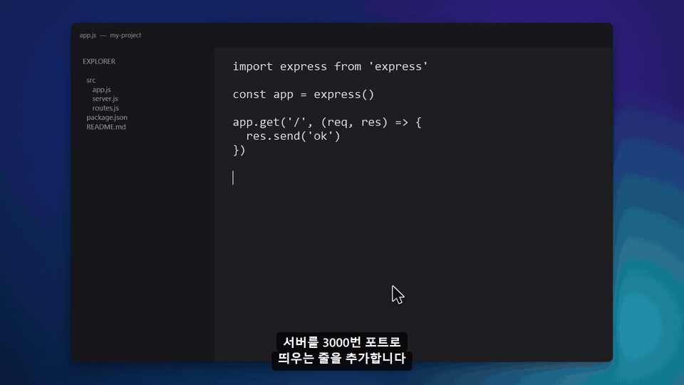

> Recorded and exported with KeyCast Studio. The subtitles in this demo were typed in. The interface comes in 12 languages: 한국어, English, 日本語, 简体中文, 繁體中文, Español, Français, Deutsch, Italiano, Nederlands, Português (Brasil), Русский ([improve a translation](CONTRIBUTING.md#translating-the-app)).

<p align="center"></p>

## About keyboard recording

<p align="center"></p>

KeyCast Studio has to see the keys you press to show them in the video, so please read this before installing.

- **When:** keys and clicks are recorded only while a recording is running. The optional "show keys without recording" mode draws them on screen and saves nothing.
- **What:** by default letters, digits and symbols typed on their own are dropped before anything is saved, so text such as passwords never reaches the recording. Shortcuts (Ctrl / Alt / Win combinations, F-keys, Esc) and keys like Enter or the arrows are kept. Turn on **타이핑한 글자도 기록** (also record typing) if you want typing in the video.
- **Where:** everything stays in `Videos\KeyCast Studio` on your computer. Nothing is sent anywhere. The internet is used only once, to download the speech model when you first make subtitles.
- **Check it yourself:** the source code is all here, and each release lists its SHA-256 checksums and a VirusTotal scan. Details in [SECURITY.md](SECURITY.md).

## Features

<p align="center">
  
  
</p>
<p align="center">
  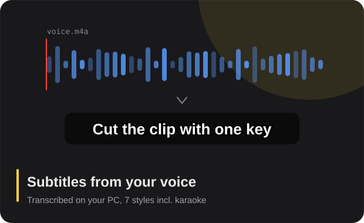
  
</p>

**Recording**
- Record the whole screen or one window, with the microphone, the computer's sound and a webcam; recordings without the pointer use Windows Graphics Capture and start in about half a second
- Keys, clicks, drags and wheel turns from any program, with their times
- Leave the real mouse pointer out of the recording and draw a larger, smoother one when editing (FFmpeg included in the installer)
- Turn the on-screen keys on and off while recording (keyboard button on the recording bar, or `Alt` + `Shift` + `K`)
- Change the stop, pause and key-display shortcuts

**Editing**
- Key bubbles: shortcuts only (default), all keys or chosen keys; 9 positions, 4 themes or your own style, 5 animations; one switch (`K`) to show or hide them in the video
- Automatic zoom to where you click, following the pointer smoothly; add and adjust zooms yourself
- Trim the ends, cut out parts in the middle, change speed by range (0.25× to 4×), undo and redo
- Text, arrow, box and picture notes, and blur to hide private details
- Backgrounds (colours, gradients, pictures or your own image), padding, rounded corners, shadow, crop, aspect ratio (16:9, 9:16, 1:1, 4:3)
- Pointer: 6 cursor packs that follow the pointer kind Windows showed (arrow, hand, text, resize, …), spring motion presets or your own stiffness, damping and mass, 4 click effects (ripple, echo, glow, burst) with size, length and strength, motion trail and hiding when still
- Webcam bubble, background music and sound effects

**Subtitles**
- Transcribe your voice on your own computer (Whisper) into sentence-sized subtitles; Korean, English, Japanese, Chinese, Spanish, German and French
- 7 styles including karaoke and pop that highlight the spoken word, text and highlight colours, entrance animations, top, middle or bottom
- Edit them, burn them into the video or save an SRT file

**Export**
- MP4 and WebM at 30 or 60 fps from 720p to 4K, and GIF; cuts, speed changes and added sound are applied

**Extensions**
- Data-only packs of backgrounds, key themes, cursor packs, click effects and subtitle styles; no code is run. See [docs/EXTENSIONS.md](docs/EXTENSIONS.md)

**Show keys without recording**
- Put your shortcuts and clicks on screen for a talk, a video call or another recording program

| Choosing what to record | Styling the key bubbles |
|---|---|
| 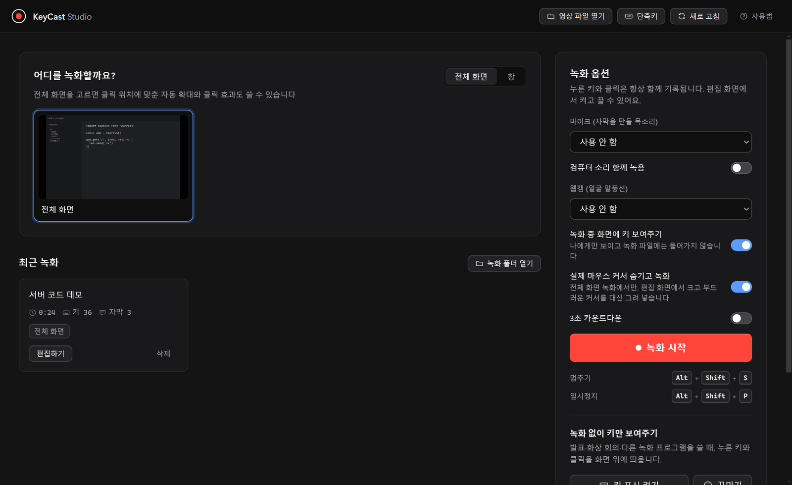 | 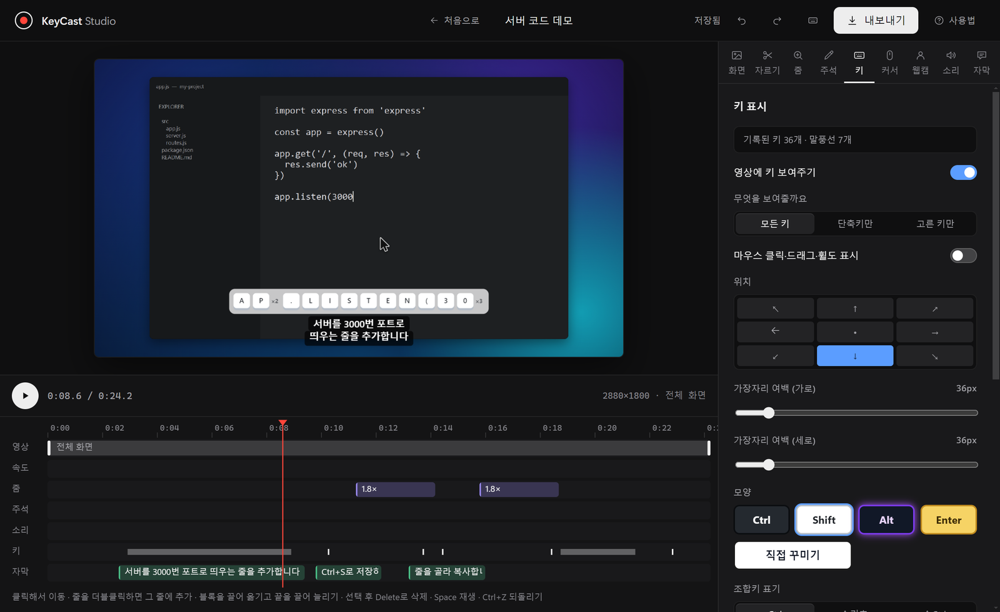 |

## Install

<p align="center"></p>

**Needs:** Windows 10 or 11, 64-bit

From the [latest release](https://github.com/dominkang90/keycast-studio/releases/latest):

| File | For |
|---|---|
| **KeyCast-Studio-Setup-x.y.z.exe** | Recommended. Installs everything, FFmpeg included, with Start menu and desktop shortcuts and an uninstaller |
| KeyCast-Studio-Portable-x.y.z.exe | One file, nothing to install: just run it. FFmpeg included. Starts a few seconds slower because it unpacks itself first |

> Windows may show **Windows protected your PC** the first time. Choose **More info → Run anyway**. The app is not code-signed yet, which is why the warning appears. Compare the file with the SHA-256 and VirusTotal links on the release page if you want to be sure.

The first time you make subtitles, the speech model (about 40 MB to 600 MB, depending on the accuracy you choose) is downloaded from Hugging Face.

## Use

1. Under **어디를 녹화할까요?** (what to record) choose the screen or a window, set the options on the right and press **녹화 시작** (start recording).
2. Work as usual. Stop with the recording bar at the top of the screen or the shortcut; the editor opens.
3. Polish it in the tabs on the right and press **내보내기** (export).

| Shortcut | Does |
|---|---|
| `Alt` + `Shift` + `S` | Stop recording and open the editor (from any program, can be changed) |
| `Alt` + `Shift` + `P` | Pause / resume recording (can be changed) |
| `Alt` + `Shift` + `K` | Show / hide the keys on screen (can be changed) |
| `Space` | Play / pause in the editor |
| `←` `→` | One frame back / forward, with `Shift` five seconds |
| `K` | Show / hide the key bubbles in the video |
| `S` | Start a cut-out part here |
| `Delete` | Delete the selected part of the timeline |
| `Ctrl` + `Z` / `Ctrl` + `Y` | Undo / redo |

## Tested on

This is a beta. So far it has been checked on one computer: Windows 11, Intel Arc graphics, a 2880×1800 screen, one monitor.

Not yet checked: Windows 10, NVIDIA and AMD graphics, more than one monitor, and a real microphone and webcam together with the hidden-pointer recording. If you try it, a [test report](https://github.com/dominkang90/keycast-studio/issues/new?template=test_report.yml) takes two minutes and helps a lot.

## Known limits

- Windows only.
- Typing Hangul shows the Latin key letters (for example `G` for `ㅎ`), because the key display is meant for shortcuts.
- Hiding the real pointer works for whole-screen recordings only.
- Without a graphics card that works for speech recognition, subtitles use the processor and can take longer than the video.

## Build from source

Needs Node.js 20 or newer and Windows.

```bash
git clone https://github.com/dominkang90/keycast-studio.git
```

```bash
cd keycast-studio
```

```bash
npm install
```

```bash
npm start
```

`npm test` runs the unit tests, `npm run build` makes `release\KeyCast Studio-win32-x64`, and `npm run dist` makes the installer and the portable exe (it needs FFmpeg 8+ on PATH to bundle). See [CONTRIBUTING.md](CONTRIBUTING.md) and [docs/ARCHITECTURE.md](docs/ARCHITECTURE.md).

## Credits

The feature set was inspired by [Recordly](https://github.com/webadderallorg/Recordly) (screen recording and editing) and [keyviz](https://github.com/mulaRahul/keyviz) (key display). No code was taken from either project.

| Project | Used for | License |
|---|---|---|
| [Electron](https://www.electronjs.org/) | Desktop app | MIT |
| [uiohook-napi](https://github.com/SnosMe/uiohook-napi) | Keys and clicks from every program | MIT |
| [Transformers.js](https://github.com/huggingface/transformers.js) / ONNX Runtime Web | Speech recognition (Whisper) | Apache-2.0 / MIT |
| [mp4-muxer](https://github.com/Vanilagy/mp4-muxer), [webm-muxer](https://github.com/Vanilagy/webm-muxer) | Writing video files | MIT |
| [gifenc](https://github.com/mattdesl/gifenc) | GIF export | MIT |
| [mediabunny](https://github.com/Vanilagy/mediabunny) | Reading video files for fast export | MPL-2.0 |
| [koffi](https://koffi.dev/) | Reading which pointer Windows shows | MIT |
| [wgc-capture](https://github.com/webadderallorg/Recordly/tree/v1.4.0/electron/native/wgc-capture) from [Recordly](https://github.com/webadderallorg/Recordly) | Screen capture with Windows Graphics Capture. Shipped unmodified, started as a separate program | AGPL-3.0 ([source](https://github.com/webadderallorg/Recordly/tree/v1.4.0/electron/native/wgc-capture)) |
| [FFmpeg](https://ffmpeg.org/) | Recording without the pointer. Shipped unmodified in the installer and the portable exe, started as a separate program | GPL-3.0 ([source](https://ffmpeg.org/download.html)) |

## License

[MIT](LICENSE). FFmpeg, which is included in the downloads, keeps its own license; see `resources\app\bin\FFMPEG-LICENSE.txt` in the installed app.
