<p align="center"></p>

<p align="center">
  <a href="README.md">English</a> · <a href="README.ko.md">한국어</a> · <a href="README.ja.md">日本語</a> · <b>简体中文</b>
</p>

<p align="center">
  一款适用于 Windows、macOS 和 Linux 的屏幕录制和编辑软件：在视频中显示你按下的快捷键，自动放大点击的位置，<br>
  用平滑的重绘指针代替真实鼠标指针，并在你自己的电脑上把语音转成字幕。<br>
  免费开源，支持 12 种语言。
</p>

<p align="center">
  <a href="https://github.com/dominkang90/keycast-studio/releases/latest">下载</a> ·
  <a href="CHANGELOG.md">更新记录</a> ·
  <a href="CONTRIBUTING.md">参与贡献</a> ·
  <a href="SECURITY.md">安全与隐私</a>
</p>

<p align="center">  <a href="https://github.com/dominkang90/keycast-studio/releases/latest"></a>  <a href="https://github.com/dominkang90/keycast-studio/actions/workflows/ci.yml"></a></p>

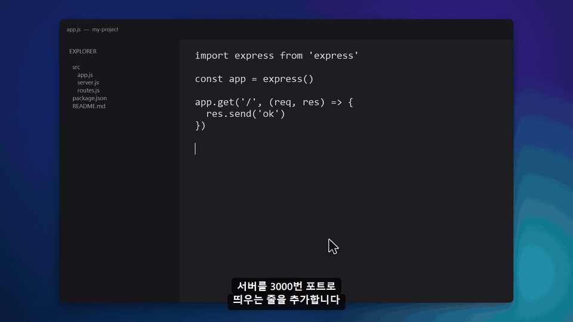

> 用 KeyCast Studio 录制并直接导出。演示中的字幕是手动输入的。应用界面支持包括简体和繁体中文在内的 12 种语言（[帮忙改进翻译](CONTRIBUTING.md#translating-the-app)）。

<p align="center"></p>

## 关于键盘记录

<p align="center"></p>

为了在视频中显示按键，软件需要读取你按下的键。安装前请先阅读。

- **何时：** 只在录制时记录按键和点击。"不录制，只显示按键"模式只在屏幕上绘制，不保存任何内容。
- **记录什么：** 默认情况下，单独输入的字母、数字和符号在保存前就会被丢弃，所以密码之类的输入不会留在录像文件中。只保留快捷键（Ctrl、Alt、Win 组合键，F 键，Esc）以及 Enter、方向键等。如果想在视频里显示打字内容，请在录制选项中打开 **타이핑한 글자도 기록**（同时记录输入的文字）。
- **存在哪里：** 一切都只保存在你电脑的 `视频\KeyCast Studio` 文件夹中，不会发送到任何地方。只有第一次生成字幕时会联网下载语音识别模型。
- **自行核实：** 全部源代码都在这里，每个版本都附有 SHA-256 校验值和 VirusTotal 扫描结果。详见 [SECURITY.md](SECURITY.md)。

## 主要功能

<p align="center">
  
  
</p>
<p align="center">
  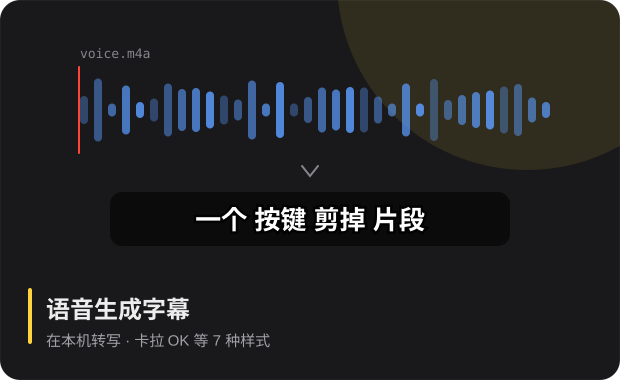
  
</p>

**录制**
- 录制整个屏幕或单个窗口，同时录入麦克风、电脑声音和摄像头
- 记录在任何程序中的按键、点击、拖动和滚轮，并带有时间
- 录制时去掉真实鼠标指针，编辑时重绘更大、更平滑的指针（Windows 已内置，macOS 和 Linux 需要 FFmpeg）
- 记录录制时显示的指针类型（箭头、手指、文字输入、调整大小等），并按相同类型重绘（Windows）
- 录制中随时开关屏幕上的按键显示（录制栏上的键盘按钮，或 `Alt` + `Shift` + `K`）
- 可以修改停止、暂停和按键显示的快捷键

**编辑**
- 按键显示：仅快捷键（默认）/ 所有按键 / 仅选定按键，9 个位置，4 种主题或自定义样式，5 种动画，按 `K` 开关视频中的按键显示
- 自动放大到点击位置并平滑跟随指针，也可以手动添加和调整放大区间
- 裁剪首尾、剪掉中间部分、按区间调整速度（0.25×～4×）、撤销与重做
- 文字、箭头、方框、图片标注，以及模糊遮挡隐私内容
- 背景（颜色、渐变、背景图、自己的图片）、边距、圆角、阴影、裁切、画面比例（16:9、9:16、1:1、4:3）
- 指针：7 种形状，4 种点击效果（波纹、回声、光晕、迸发）可调大小和时长，平滑、拖影、静止时隐藏
- 摄像头气泡、背景音乐和音效
- 打开其他程序制作的视频；Recordly 的录制会连同指针、点击和自动缩放一起导入

**字幕**
- 在本机把语音转写成文字（Whisper），按句生成字幕；支持韩语、英语、日语、中文、西班牙语、德语、法语
- 7 种样式，包括高亮当前单词的卡拉 OK 和强调弹出，文字色与高亮色、出现动画、上中下位置
- 可编辑，可烧录进视频或保存为 SRT 文件

**导出**
- MP4、WebM（30/60fps，720p～4K）和 GIF；剪切、变速和添加的声音都会生效
- 1920×1200 及以下的录制导出比视频本身更快（11 秒视频约 6 秒）

**扩展**
- 添加背景、按键主题、指针包、点击效果和字幕样式的数据包，不运行任何代码。内置 6 个官方扩展，还可在**制作扩展**界面中边看实时预览边制作。详见 [docs/EXTENSIONS.md](docs/EXTENSIONS.md)

**界面**
- 12 种语言：한국어, English, 日本語, 简体中文, 繁體中文, Español, Français, Deutsch, Italiano, Nederlands, Português (Brasil), Русский，首次启动时跟随系统语言
- 按 Windows 方式（Ctrl、Alt、Win）或 Mac 方式（⌃ Control、⌥ Option、⌘ Cmd）显示按键名称

**不录制，只显示按键**
- 在演讲、视频会议或使用其他录屏软件时，把快捷键和点击显示在屏幕上

| 选择录制内容 | 设置按键样式 |
|---|---|
| 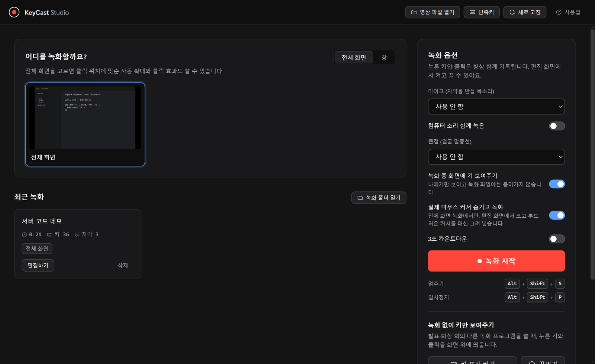 | 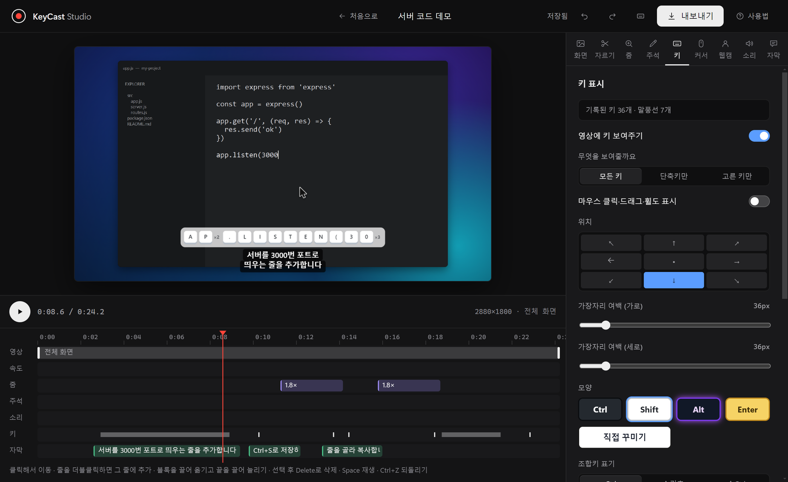 |

## 安装

<p align="center"></p>

**需要：** Windows 10/11（64 位）、macOS 11 或更高版本（Apple 芯片或 Intel），或使用 X11 的 64 位 Linux。macOS 和 Linux 版在 2.0 中新增，目前只经过自动检查。macOS 首次请右键点击 →“打开”，并允许“辅助功能”和“屏幕录制”（不带指针录制需要 `brew install ffmpeg`）。Linux 请使用 `.AppImage` 或 `.deb`，在 X11 会话中才能记录按键和点击（`sudo apt install ffmpeg`）。录制电脑声音仅支持 Windows。

从[最新版本](https://github.com/dominkang90/keycast-studio/releases/latest)下载：

| 文件 | 用途 |
|---|---|
| **KeyCast-Studio-Setup-x.y.z.exe** | 推荐。安装全部内容（含 FFmpeg），创建开始菜单和桌面快捷方式以及卸载程序 |
| KeyCast-Studio-Portable-x.y.z.exe | 单个文件，免安装直接运行，包含 FFmpeg。每次启动先自解压，所以会慢几秒 |

> 首次运行时如果出现 **Windows 已保护你的电脑**，请点 **更多信息 → 仍要运行**。这是因为软件还没有代码签名。可以用发布页上的 SHA-256 和 VirusTotal 结果核对文件。

第一次生成字幕时，会从 Hugging Face 下载一次语音识别模型（根据精度约 40MB～600MB）。

## 使用方法

1. 在 **要录制哪里？** 中选择整个屏幕或一个窗口，设置右侧的录制选项，然后点 **开始录制**。语言可在右上角的菜单中切换。
2. 照常工作。用屏幕顶部的录制栏或快捷键停止后，会打开编辑器。
3. 在右侧的标签（画面、剪切、缩放、注释、按键、指针、摄像头、声音、字幕）中调整，然后点 **导出** 保存。

| 快捷键 | 作用 |
|---|---|
| `Alt` + `Shift` + `S` | 停止录制并打开编辑器（任何程序中都可用，可修改） |
| `Alt` + `Shift` + `P` | 暂停 / 继续录制（可修改） |
| `Alt` + `Shift` + `K` | 显示 / 隐藏屏幕上的按键（可修改） |
| `Space` | 在编辑器中播放 / 暂停 |
| `←` `→` | 前后移动一帧，按住 `Shift` 为 5 秒 |
| `K` | 显示 / 隐藏视频中的按键气泡 |
| `S` | 从这里开始一段剪切 |
| `Delete` | 删除时间线上选中的部分 |
| `Ctrl` + `Z` / `Ctrl` + `Y` | 撤销 / 重做 |

在 Mac 上，`Alt` 是 `Option` 键，撤销 / 重做是 `Cmd` + `Z` / `Y`。

## 测试环境

这是测试版。

- **Windows**：在一台电脑（Windows 11、Intel Arc 显卡、2880×1800 屏幕、一台显示器）上手动检查过安装包、便携 exe 和 24 项内置自检。
- **macOS 和 Linux**：每次发布都在 GitHub 的 Mac 和 Linux 机器上构建，并自动启动一次，检查窗口能打开、首页能显示、按键记录模块能加载。还没有人在真实的 Mac 或 Linux 电脑上录制过。

尚未检查：Windows 10、NVIDIA 和 AMD 显卡、多台显示器、真实麦克风和摄像头与隐藏指针录制同时使用，以及真实的 Mac 和 Linux 电脑。如果你试用过，[提交测试报告](https://github.com/dominkang90/keycast-studio/issues/new?template=test_report.yml) 只需两分钟，帮助很大。

## 已知限制

- 录制电脑声音仅支持 Windows。
- macOS：尚未经过 Apple 公证，首次请右键点击 →“打开”，并需要“辅助功能”和“屏幕录制”权限。隐藏指针需要 FFmpeg（`brew install ffmpeg`）。
- Linux：记录按键、点击和隐藏指针需要 X11 会话；在 Wayland 下只能录制画面。
- 指针类型（手指、文字输入等）只在 Windows 上记录，其他系统画成箭头。
- 隐藏真实指针只适用于整个屏幕的录制。
- 韩语和英语以外的翻译借助了机器翻译，仍需母语者检查。
- 如果没有可用于语音识别的显卡，字幕会用 CPU 生成，耗时可能比视频还长。

## 从源代码构建

需要 Node.js 20 或更高版本（Windows、macOS、Linux 均可）。

```bash
git clone https://github.com/dominkang90/keycast-studio.git
```

```bash
cd keycast-studio
```

```bash
npm install
```

```bash
npm start
```

`npm test` 运行单元测试。`npm run dist` 生成 Windows 安装包和便携 exe（打包 `FFMPEG_PATH` 或 PATH 中的 FFmpeg 8 以上，并下载 wgc-capture），`npm run dist:mac` 生成 macOS 的 dmg 和 zip，`npm run dist:linux` 生成 AppImage 和 deb。推送版本标签后，GitHub Actions 会生成 Mac 和 Linux 版本。参见 [CONTRIBUTING.md](CONTRIBUTING.md) 和 [docs/ARCHITECTURE.md](docs/ARCHITECTURE.md)。

## 致谢与开源组件

功能设计参考了 [Recordly](https://github.com/webadderallorg/Recordly)（屏幕录制与编辑）和 [keyviz](https://github.com/mulaRahul/keyviz)（按键显示），没有使用这两个项目的代码。

| 名称 | 用途 | 许可证 |
|---|---|---|
| [Electron](https://www.electronjs.org/) | 桌面应用 | MIT |
| [uiohook-napi](https://github.com/SnosMe/uiohook-napi) | 记录所有程序中的按键和点击 | MIT |
| [Transformers.js](https://github.com/huggingface/transformers.js) / ONNX Runtime Web | 语音识别（Whisper） | Apache-2.0 / MIT |
| [mp4-muxer](https://github.com/Vanilagy/mp4-muxer), [webm-muxer](https://github.com/Vanilagy/webm-muxer) | 生成视频文件 | MIT |
| [gifenc](https://github.com/mattdesl/gifenc) | 生成 GIF | MIT |
| [mediabunny](https://github.com/Vanilagy/mediabunny) | 为快速导出读取视频 | MPL-2.0 |
| [koffi](https://koffi.dev/) | 读取 Windows 当前显示的指针类型 | MIT |
| [wgc-capture](https://github.com/webadderallorg/Recordly/tree/v1.4.0/electron/native/wgc-capture) ([Recordly](https://github.com/webadderallorg/Recordly)) | 使用 Windows Graphics Capture 捕获屏幕。以未修改的形式包含，作为独立程序运行 | AGPL-3.0 |
| [FFmpeg](https://ffmpeg.org/) | 不带指针的屏幕捕获。以未修改的形式包含在安装包和便携 exe 中，作为独立程序运行 | GPL-3.0（[源代码](https://ffmpeg.org/download.html)） |

## 许可证

[MIT](LICENSE)。随附的 FFmpeg 遵循其自身的许可证，见已安装应用中的 `resources\app\bin\FFMPEG-LICENSE.txt`。
