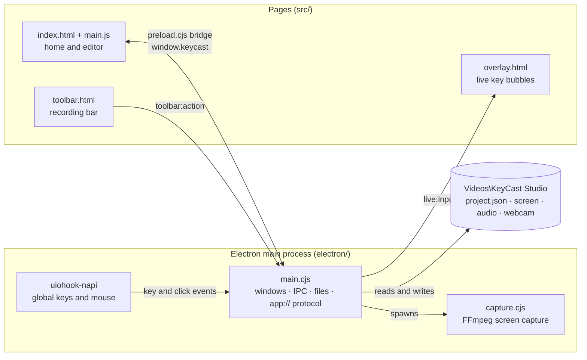

# Architecture

A map of the code for people who want to change it. Start with the picture, then read only the part you need.



## The three windows

| Window | File | Job |
|---|---|---|
| Studio | `src/index.html` → `src/main.js` | Home screen and editor. Hidden while recording |
| Recording bar | `src/toolbar.html`, `src/toolbar.js` | Time, key display toggle, pause, stop. Kept out of the recording with `setContentProtection` |
| Live keys | `src/overlay.html`, `src/overlay.js` | Transparent, click-through window that draws key bubbles and clicks while recording, or in "show keys without recording" mode |

All pages are served from the custom `app://local/` protocol (see `registerProtocol` in `electron/main.cjs`). Recordings are served from `app://local/media/<project id>/<file>`.

## Folders

```
electron/
  main.cjs        windows, global shortcuts, IPC handlers, file writing, app:// protocol
  preload.cjs     the only bridge from the pages: window.keycast.*
  capture.cjs     FFmpeg capture without the mouse pointer, joining segments and sound
  keys.cjs        key codes → names shown on screen
  webm.cjs        writes the duration into WebM files made by MediaRecorder
src/
  main.js         entry point: wires the screens together
  ui/             one file per screen or dialog (DOM code)
    dom.js        h() element helper, toast, form controls (switch, slider, select…)
    state.js      app state and preferences in localStorage (options, look, shortcuts)
    home.js       home screen, recent recordings, opening a video file, keys-only mode
    recording.js  countdown, start, pause, stop
    editor.js     editor: preview loop, timeline wiring, settings tabs, export dialog
    key-panel.js  key display settings, shared by the editor and the key style dialog
    dialogs.js    key style and shortcut dialogs, focus handling for every dialog
    selftest.js   the scripted self-test (KEYCAST_SELFTEST)
  i18n/           interface translations (en.js); the Korean text in the code is the key
  lib/            logic without the DOM; most of it is unit-tested in tests/run.mjs
    recorder.js   records screen, microphone, computer sound and webcam; builds project.json
    keys.js       turns key events into bubbles; the typing filter
    zoom.js       automatic zoom regions and the camera that follows the pointer
    timemap.js    cut-out parts and speed regions: recording time ↔ video time
    compositor.js draws one finished frame (background, screen, cursor, notes, keys, subtitles, webcam)
    timeline.js   the timeline canvas: blocks, dragging, selection
    exporter.js   frame-exact MP4/WebM with WebCodecs, GIF with gifenc
    transcribe.js speech to text with Whisper in a worker (transcribe.worker.js)
    subtitles.js  shaping recognised text into readable subtitles, SRT
    platform.js   one interface over the desktop app and a plain browser tab
    icons.js      the line icons
tests/
  run.mjs         unit tests (node tests/run.mjs)
  check-package.cjs  checks the packaged app has its files
scripts/          icon, FFmpeg bundling, starting the packaged app
build/            icon sources and generated .png / .ico
```

## How a recording becomes a video

1. **Start** (`src/ui/recording.js` → `Recorder.start()` in `src/lib/recorder.js`). The page asks the main process to begin (`recording:begin`): it starts the key hook, the shortcuts, the recording bar and the live key window. The screen is captured either by the browser (`getDisplayMedia` + `MediaRecorder`) or, when the pointer is hidden, by FFmpeg (`capture:start`), one segment per stretch between pauses. Microphone and webcam are recorded by `MediaRecorder`.
2. **Stop.** The main process returns the raw events (`recording:end`). The recorder converts wall-clock times to recording time, drops typed characters unless "also record typing" is on (`keepWithoutTyping`), joins FFmpeg segments with their sound (`capture:finish`) and saves `project.json`.
3. **Edit** (`src/ui/editor.js`). The preview loop calls `renderFrame()` (`src/lib/compositor.js`) for the current time on every animation frame. Every change goes through `markDirty()`, which re-derives what is needed, records undo history and saves `project.json` 600 ms later.
4. **Export** (`src/lib/exporter.js`). The recording is played piece by piece (`segments()` in `timemap.js` skips cut-out parts and applies speed), each output frame is drawn with the same `renderFrame()` and encoded with exact timestamps.

## The project file

`Videos\KeyCast Studio\<id>\project.json` holds everything except the media:

| Field | Meaning |
|---|---|
| `files` | `screen`, and optionally `voice` (microphone), `audio` (computer sound only), `webcam` |
| `durationMs`, `source` | Length; what was recorded and its size |
| `events` | `{ t, type, … }` with `t` in seconds: `kd`/`ku` key down/up (`name`, `mods`, `repeat`), `md`/`mu` mouse down/up, `mm` move, `wh` wheel (`x`,`y` are 0–1 across the screen) |
| `typingRecorded`, `cursorHidden`, `inputHooked` | How it was recorded |
| `settings` | `frame`, `zoom`, `cursor`, `keys`, `webcam`, `subtitles`, `audio` (defaults in `defaultSettings()` in `compositor.js`) |
| `zooms`, `subtitles`, `cuts`, `speeds`, `annotations`, `audios` | Timeline blocks, each `{ id, start, end, … }` in recording seconds |
| `trim` | `{ start, end }` |

Old projects are upgraded when opened (`migrate()` in `editor.js`), so new fields need a default there.

## Where to make common changes

| To… | Look at |
|---|---|
| Add a setting to a tab | the tab's function inside `drawPanel()` in `src/ui/editor.js`, the default in `defaultSettings()` (`compositor.js`), and its drawing in `compositor.js` |
| Change how key bubbles are grouped or filtered | `buildKeyGroups()` in `src/lib/keys.js` (+ a test) |
| Change how key bubbles look | `drawKeys()` and `resolveKeyTheme()` in `src/lib/compositor.js` |
| Add a timeline row | `TRACKS`, `ROWS` and `render()` in `src/lib/timeline.js`, plus `addItem()` in `editor.js` |
| Add an IPC call | handler in `electron/main.cjs`, bridge in `electron/preload.cjs`, wrapper in `src/lib/platform.js` |
| Change export | `exportExact()` / `exportGif()` in `src/lib/exporter.js` |
| Add or change interface text | wrap it in `T()` from `src/lib/i18n.js` and add the English to `src/i18n/en.js` |
| Add a subtitle style or click effect | `SUBTITLE_STYLES` + `drawSubtitle()`, or `CLICK_EFFECTS` + `drawClicks()` in `src/lib/compositor.js` |

## Rules worth keeping

- Pages never get Node access; everything goes through `window.keycast` in `preload.cjs`.
- Paths from pages are checked against the recordings folder in the main process (`projectDir()`, `inside()`).
- The recording bar and live key window use content protection, so they never appear in the video.
- New interface text is short Korean without a trailing full stop (see CONTRIBUTING).
